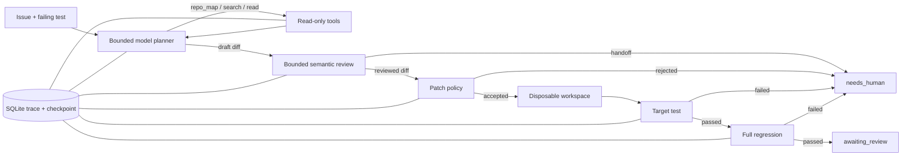

# TraceRepair

> A bounded, traceable, and test-gated code-repair agent.

[](https://github.com/zhangbeimiao/TraceRepair/actions/workflows/ci.yml)
[](https://zhangbeimiao.github.io/TraceRepair/)
[](https://github.com/zhangbeimiao/TraceRepair/releases/tag/v0.8.0)

**在线 Demo：<https://zhangbeimiao.github.io/TraceRepair/>**

一条命令离线回放冻结证据，不需要 API Key、不访问网络，也不修改仓库：

```powershell
python scripts\showcase.py
```

第三方也可以用一条离线命令核验报告校验和、完整 SHA-256 账本链、冻结摘要与 Agent 配置是否一致；该命令不需要 API Key、不运行 pytest，也不执行任何第三方仓库代码：

```powershell
python scripts\verify_benchmark_evidence.py
python scripts\verify_blind_evidence.py
python scripts\verify_benchmark_evidence.py --benchmark function-rag-locked-v0.8.0
```

可用 `--section evidence|repair|failure|recovery` 只展示一个环节，或用 `--case 10` 切换成功修复案例。

Demo 只回放冻结并脱敏的真实 Trace，不需要 API Key，也不会产生模型费用。`evidence` 区展示 `0.8.0` 三仓库 `2/3` 及 `0.7.0-dev2` 六仓库 `2/6` 的各自 locked one-shot 盲测；`repair`、`failure` 和 `recovery` 区展示独立的 EventRelay 受控工程 Trace，不计入真实仓库指标。

TraceRepair 是一个面向受信任小型 Python 仓库的受控代码修复 Agent。大模型负责在不确定环境中选择搜索、读取和补丁动作；确定性控制器负责权限、状态、成本、测试和人工审核。模型不能直接运行 Shell，也不能绕过验证门禁修改仓库。仓库差异由 JSON 任务配置描述，不再写死 EventRelay 路径。

> **Agent 0.8.0**：原生 Function Calling、Prompt Registry 和只读 Code RAG 已纳入 LangGraph 工作流。在三个预注册的新仓库上各运行一次，得到 **2/3 pass@1、1 次安全转人工、0 个错误补丁被接受**；通过测试的补丁仍需人工审核。三个任务不足以估计通用修复率。完整结果见 [`LOCKED_FINDINGS.md`](evaluation/results/function-rag-locked-v0.8.0/LOCKED_FINDINGS.md)。

首次原生协议开发运行得到 `0/5`：五题均因 Function Calling 格式契约不兼容而安全停止，完整负面结果保存在 [`DEVELOPMENT_FINDINGS.md`](evaluation/results/function-calling-v0.8.0-dev1/DEVELOPMENT_FINDINGS.md)。真实语义检索与 FTS5 的 Recall@K/MRR 完全持平，因此激活门槛返回 `keep_rag_disabled`。两项结果都保留，不以调参后的结果覆盖。

针对该失败新建了 `0.8.0-dev1.1`，没有重写旧账本。修订只处理协议兼容：`reason` 被降为非授权审计元数据，并把供应商偶发返回的 `apply_patch(patch=...)` 严格归一化为候选 `propose_patch(unified_diff=...)`。它依然不能写文件、运行测试或改变状态；阶段白名单、Diff 策略、目标测试和回归门禁全部不变。相同五题开发集结果为 **`3/5 pass@1`、`2/5` 安全转人工、错误接受补丁 `0`，格式失败率由 `100%` 降至 `0%`**。完整结果和失败边界见 [`DEVELOPMENT_FINDINGS.md`](evaluation/results/function-calling-v0.8.0-dev1.1/DEVELOPMENT_FINDINGS.md)。

在相同五题上激活 `0.8.0-dev2.1` Code RAG 后，端到端结果仍为 **`3/5 pass@1`、`2/5` 安全转人工、错误接受补丁 `0`**，所以项目不宣称 RAG 提高了修复率。平均输出 Token 从 `489.6` 降至 `473.6`，P95 从 `51.234s` 降至 `18.906s`；由于只有五个已知任务，这些只作为描述性开发数据。一个失败中 RAG 正确找到 HTTPie 的目标符号，但模型返回的 malformed hunk 被 `PATCH_PARSE_ERROR` 拒绝，候选原文和停止证据均已保留。完整对比见 [`DEVELOPMENT_FINDINGS.md`](evaluation/results/rag-repair-v0.8.0-dev2.1/DEVELOPMENT_FINDINGS.md)。

`0.8.0` 的配置、任务及 oracle 在运行前已预注册；`jaraco.text`、`python-sortedcontainers` 两题通过目标测试和回归，`structlog` 因源码切片未覆盖目标方法而安全转人工。每题仅尝试一次，全部结果公开。预注册边界见 [`docs/v0.8-locked-preregistration.md`](docs/v0.8-locked-preregistration.md)。

后续已知开发集保留了三轮原始结果：`0.8.1-dev1` **2/3**、`0.8.2-dev1` **0/3**、`0.8.3-dev1` **2/3**。它们均使用相同的三个已观察任务，每题每版一次，样本太小且模型存在随机性，不能据此声称性能提升。各轮保留成功和失败、日志、报告及哈希链：[`0.8.1`](evaluation/results/source-refinement-v0.8.1-dev1/DEVELOPMENT_FINDINGS.md)、[`0.8.2`](evaluation/results/missing-symbol-v0.8.2-dev1/DEVELOPMENT_FINDINGS.md)、[`0.8.3`](evaluation/results/context-preservation-v0.8.3-dev1/DEVELOPMENT_FINDINGS.md)。

`0.8.4-dev1` 将初始源码片段与同文件的一次补读分别保存，每段仍受 200 行上限约束；恢复时分别校验工作区内容，已读取的目标测试证据也纳入恢复校验。模型上下文裁剪会记录，不改变补丁及测试门禁。[`开发评测配置`](evaluation/benchmarks/multi-slice-v0.8.4-dev1.json) 和旧结果保持不变。
`0.8.4-dev1` 随后在三个已知开发任务上得到 **2/3**：tqdm 的 Trace 显示三轮诊断用尽后不可补读，且源码和测试证据均被截断；详见[原始开发证据](evaluation/results/multi-slice-v0.8.4-dev1/DEVELOPMENT_FINDINGS.md)。下一开发版 `0.8.5-dev1` 为补读设立独立的一次预算，并将模型调用上限从 5 提至 6；它尚未取得新的模型评测结果。以上开发集不能作为盲测或泛化结论。

配置好百炼环境变量后，可用 `powershell -ExecutionPolicy Bypass -File scripts\run_v080_development.ps1` 一次完成 Function Calling 探针、五题开发集、协议对比和语义检索评测；该入口不包含 locked 任务。检索门禁未达到提升标准时会保存 `keep_rag_disabled` 负面证据并正常结束，只有报告损坏或配置不一致才作为基础设施错误失败。也可以在 GitHub Actions 中手动触发 `TraceRepair v0.8 Development Evaluation`：它只读取仓库 Secrets、上传完整开发证据，并且没有引用任何 locked manifest。

当前公开稳定基线为 `0.6.0`（评测运行时 `0.6.0-dev4`），当前 LangGraph 冻结候选为 `0.7.0-dev2`。稳定基线在五个来自不同开源仓库历史提交的 Bug 上，严格 `pass@1` 结果为 **3/5**：开发集 `2/3`，配置冻结后的锁定集 `1/2`，锁定任务每题只运行一次。两个失败候选都被目标测试拦截并转人工，**错误接受补丁数为 0**。样本量仍小，因此这里只证明受控闭环、一次性锁定迁移和安全停止能力，不宣称任意仓库修复准确率。

`0.7.0-dev2` 使用完整 LangGraph 端到端编排，并在补丁生成与应用之间新增一次受限语义复核：`generate_patch → review_patch → apply_patch`。复核器只能返回修订后的 unified diff 或交给人工，没有工具、文件写入、Shell、测试和状态修改权限。LangGraph 未配置 checkpointer；SQLite 仍是任务状态、预算、Trace 与恢复 Checkpoint 的唯一持久化源。该版本先在五个**已知开发任务**上取得 `4/5 pass@1`，随后冻结全部配置，分两批预注册 toolz、prettytable、glom、cachetools、python-slugify、Click 六个从未用于调试的仓库并执行 locked one-shot 盲测。合计结果为 **`2/6 pass@1`、`4/6` 安全转人工、错误接受补丁 `0`**；每题只运行一次，失败没有重试，全部结果原样公开。两批证据保留独立哈希链，聚合文件只做可验证索引，不重写原始账本。

前一开发版 `0.7.0-dev1` 在相同五个任务上的结果为 `2/5`。加入语义复核后，`0.7.0-dev2` 提升到 `4/5`，错误接受补丁仍为 0；代价是平均输出 Token 从 `315.6` 增至 `543.2`，P50 时延从 `9.985s` 增至 `14.329s`。剩余的 tqdm 候选通过补丁策略但未通过目标测试，已连同原始 Diff 和失败摘要永久保留。完整对比见 [`docs/langgraph-dev1-vs-dev2.md`](docs/langgraph-dev1-vs-dev2.md)。

## 评测结果

### 真实历史 Bug（主要结论）

| 协议 | Agent | 真实历史 Bug | pass@1 | 安全拒绝 | 错误接受补丁 | 平均输出 Tokens |
|---|---|---:|---:|---:|---:|---:|
| 全新仓库、冻结配置、locked one-shot | `0.8.0` | 3 | **2/3（66.67%）** | 1 | **0** | 414.33 |
| 已知开发任务、原生 Function Calling + Code RAG | `0.8.0-dev2.1` | 5 | **3/5（60%）** | 2 | **0** | 473.60 |
| 已知开发任务、原生 Function Calling、无 RAG | `0.8.0-dev1.1` | 5 | **3/5（60%）** | 2 | **0** | 489.60 |
| 全新仓库、冻结配置、locked one-shot | `0.7.0-dev2` | 6 | **2/6（33.33%）** | 4 | **0** | 455.00 |
| 已知开发任务、语义复核机制评测 | `0.7.0-dev2` | 5 | **4/5（80%）** | 1 | **0** | 543.20 |
| 相同开发任务、迁移基线 | `0.7.0-dev1` | 5 | **2/5（40%）** | 3 | **0** | 315.60 |
| 冻结配置、pass@1 | `0.6.0` | 5 | **3/5（60%）** | 2 | **0** | 273.80 |
| 历史基线（不同题集） | `0.5.0` | 3 | **2/3（66.67%）** | 1 | **0** | 268.67 |

`0.8.0` 的三题与 `0.7.0-dev2` 的六题来自不同仓库，不能据此直接归因版本提升；两组样本均小且经过筛选。两行 `0.8` 开发任务对比也不是泛化证据。

- `toolz-empty-interpose`：目标测试与回归测试均通过，进入 `awaiting_review`。
- `prettytable-horizontal-align`：目标测试通过，但完整回归失败，候选未被接受并转人工。
- `glom-path-index-boundary`：语义复核返回非法结构化 `reason`，候选未应用、测试未启动并转人工。
- `python-slugify-invalid-types`：候选通过目标测试与完整回归，进入 `awaiting_review`。
- `cachetools-falsey-getsizeof`、`click-sentinel-copy`：补丁生成响应违反结构化 `reason` 契约，没有形成可执行 Diff，写入和测试均未开始。
- 六个任务分两批在任何模型调用前完成任务、Prompt、Agent 配置、模型和 oracle 预注册；两份预注册文件都先于对应结果提交到 GitHub。

- Development：PySnooper、tqdm、TheFuck，`2/3`；只有这三题用于调整 `0.6.0`。
- Locked one-shot：HTTPie、youtube-dl，`1/2`；冻结配置后各运行一次，没有失败重试或事后调参。
- 两个失败均为候选 Diff 通过补丁策略并写入一次性副本后，目标测试仍失败；控制器停止在完整回归之前，未接受错误补丁。
- 每个任务先运行 oracle 预检：修复前提交必须使目标测试失败，历史修复后提交必须通过目标测试和回归测试。
- 所有尝试（包括失败）追加到 SHA-256 哈希链；最终报告、终端账本和 Agent 配置均有独立摘要。

冻结证据：

- `evaluation/benchmarks/langgraph-review-offline-v0.7.0-dev2.json`
- `evaluation/frozen/agent-v0.7.0-dev2.json`
- `evaluation/frozen/langgraph-review-offline-v0.7.0-dev2.json`
- `evaluation/frozen/langgraph-review-offline-v0.7.0-dev2.json.sha256`
- `evaluation/results/langgraph-review-offline-v0.7.0-dev2/DEVELOPMENT_FINDINGS.md`
- `evaluation/results/langgraph-review-offline-v0.7.0-dev2/failures/tqdm-sizeless-bool.diff`
- `evaluation/benchmarks/langgraph-blind-v0.7.0-dev2.json`
- `evaluation/frozen/langgraph-blind-v0.7.0-dev2-preflight.json`
- `evaluation/frozen/langgraph-blind-v0.7.0-dev2.json`
- `evaluation/frozen/langgraph-blind-v0.7.0-dev2.json.sha256`
- `evaluation/results/langgraph-blind-v0.7.0-dev2/LOCKED_FINDINGS.md`
- `evaluation/results/langgraph-blind-v0.7.0-dev2/failures/`
- `evaluation/benchmarks/langgraph-blind-extension-v0.7.0-dev2.json`
- `evaluation/frozen/langgraph-blind-extension-v0.7.0-dev2-preflight.json`
- `evaluation/frozen/langgraph-blind-extension-v0.7.0-dev2.json`
- `evaluation/frozen/langgraph-blind-extension-v0.7.0-dev2.json.sha256`
- `evaluation/results/langgraph-blind-extension-v0.7.0-dev2/LOCKED_FINDINGS.md`
- `evaluation/results/langgraph-blind-extension-v0.7.0-dev2/failures/`
- `evaluation/results/langgraph-blind-extension-v0.7.0-dev2/successes/`
- `evaluation/frozen/langgraph-blind-six-repository-v0.7.0-dev2.json`
- `evaluation/frozen/langgraph-blind-six-repository-v0.7.0-dev2.json.sha256`
- `evaluation/benchmarks/historical-python-v1.1.3.json`
- `evaluation/frozen/agent-v0.6.0.json`
- `evaluation/results/historical-python-v1.1.3/report.json`
- `evaluation/results/historical-python-v1.1.3/attempts.jsonl`
- `evaluation/frozen/historical-python-v1.1.3.json`
- `evaluation/frozen/historical-python-v1.1.3.json.sha256`

任何补丁定位策略、预算或 Prompt 的改动，都必须提升 Agent 版本并创建新的 benchmark manifest 与结果目录；**不得覆盖或重跑 `historical-python-v1.1.3` 的锁定结果**。`0.5.0 / historical-python-v1.0.0` 的 `2/3` 也永久保留。两个版本题集不同，百分比不能解释为直接精度升降。

### 受控工程回归证据（次要结论）

| 数据集 | Bug 类型 | 运行次数 | 成功 | 平均输出 Tokens | 平均工具调用 |
|---|---:|---:|---:|---:|---:|
| Development | 4 | 8 | 8/8 | 212.62 | 5.0 |
| Locked one-shot | 5 | 5 | 5/5 | 243.20 | 5.0 |
| Combined | 9 | 13 | 13/13 | 224.38 | 5.0 |
| Public configured repository | 1 | 5 | 5/5 | 179.60 | 5.0 |
| Held-out repository one-shot | 1 | 1 | 1/1 | 234.00 | 5.0 |

锁定集中的 `02、04、06、08、09` 每个只运行一次；测试期间没有重试失败案例，也没有修改模型 Prompt 或控制策略。完整证据保存在：

- `evaluation/frozen/devset-v0.4.0-dev1.json`
- `evaluation/frozen/testset-v0.4.0-dev1.json`
- `evaluation/frozen/release-summary-v0.4.0-dev1.json`
- `evaluation/frozen/failure-showcase-v0.4.0.json`
- `evaluation/frozen/recovery-showcase-v0.4.1.json`
- `evaluation/frozen/repository-mini-repo-discount-v0.6.1.json`
- `evaluation/frozen/locked-repository-v0.6.1.json`

前 13 次运行描述自建 EventRelay 受控基准；MiniMath 的 `5/5` 只证明该公开任务的重复稳定性；最后一行是早期未公开仓库的一次性结果。它们用于证明状态机、工具门禁、恢复与跨仓库配置机制，不作为真实历史 Bug 的主成功率，也不能解释为任意仓库都有 100% 修复率。

## 30 秒介绍

用户提交 Issue 和失败测试后，Agent 在最多三轮诊断中选择受限的代码搜索与读取工具，生成候选 unified diff，并由无执行权限的语义复核节点选择原样保留、修订或交给人工。最终 Diff 必须依次通过路径与变更量策略、目标测试和完整回归测试；全部通过后仍只进入 `awaiting_review`。所有模型决策、工具生命周期、状态迁移和 checkpoint 都持久化到 SQLite。LangGraph `0.7.0-dev2` 在五个已知开发任务上由 **2/5 提升到 4/5**；随后六个全新仓库的一次性盲测为 **2/6 pass@1**，其余四题被回归门禁或结构化输出校验安全拦截，错误接受补丁为 0。

## 架构

完整的分层架构、状态边界与恢复路径见
[`docs/agent-architecture.md`](docs/agent-architecture.md)；可直接练习的三分钟项目讲稿见
[`docs/interview-pitch.md`](docs/interview-pitch.md)。
当前 LangGraph 迁移范围、恢复证据与重新评测规则见
[`docs/langgraph-migration-v0.7.0-dev1.md`](docs/langgraph-migration-v0.7.0-dev1.md)；受限语义复核的权限边界见
[`docs/patch-review-v0.7.0-dev2.md`](docs/patch-review-v0.7.0-dev2.md)。
Prompt、原生 Function Calling 与 Code RAG 的开发协议见
[`docs/v0.8-function-calling-rag.md`](docs/v0.8-function-calling-rag.md)。



正式运行时由 LangGraph 显式编排 `diagnose → checkpoint_source → generate_patch → review_patch → apply_patch → run_target → run_regression`；重启时从 SQLite 校验后的恢复阶段路由到 `generate_patch`、`run_target` 或 `run_regression`。图状态只在进程内存在，不构成第二套持久化真相源；补丁已持久化落盘后的验证恢复不会再次调用生成器或复核器。

| 模型负责 | 控制器负责 |
|---|---|
| 判断下一步搜索什么 | 限制可调用工具和参数 |
| 选择需要读取的源码 | 路径白名单和行数上限 |
| 根据证据提出候选 Diff | 补丁范围、体积和上下文校验 |
| 在无执行权限的复核阶段保留、修订 Diff 或交给人工 | 只允许复核结果进入确定性验证门禁 |
| 信息不足时请求人工处理 | Token、轮次、超时和状态机 |
| — | 目标测试、完整回归和人工审核 |

## 为什么需要 Agent

固定工作流可以执行已知步骤，但无法提前知道 Bug 位于哪个文件、应该搜索什么符号、需要读取哪段上下文。TraceRepair 让模型处理这些不确定决策，同时把写文件、执行测试和状态迁移留给可验证代码。

如果任务只是固定格式转换，直接调用 API 或普通工作流更合适；只有当下一步行动依赖前一步观察结果时，Agent 循环才有价值。

## 五分钟运行 Demo

项目必须放在 D 盘。首次安装：

```powershell
cd D:\AI-Agent-Intern\TraceRepair
powershell -ExecutionPolicy Bypass -File scripts\setup.ps1
```

执行完整测试、敏感信息扫描和 Demo 数据导出：

```powershell
powershell -ExecutionPolicy Bypass -File scripts\verify.ps1
```

启动本地 Web Demo：

```powershell
powershell -ExecutionPolicy Bypass -File scripts\start_demo.ps1
```

浏览器访问 `http://127.0.0.1:8765/`。Demo 使用已经冻结并脱敏的 Trace，不需要 API Key，也不会连接公网。页面中的 Diff 由故障快照与一次性修复工作副本重建，并用 Trace 中记录的 SHA-256 校验；它不是预先写死的示意代码。

运行不消耗 API Token 的两阶段崩溃恢复演示：

```powershell
python scripts\checkpoint_recovery_demo.py --crash-after source_read
python scripts\checkpoint_recovery_demo.py --crash-after patch_applied
```

两个命令都会关闭并重新打开 SQLite、重建运行时对象，并检查最终工具序列中没有重复项。`patch_applied` 场景恢复阶段的模型调用数为 0。

运行不消耗 API Token 的跨仓库演示：

```powershell
python scripts\generic_repository_demo.py
```

它会读取 `examples/tasks/mini-repo.json`，把独立 MiniMath 仓库复制到一次性工作区，确认目标测试先失败，再完成 `search → read → patch → target → regression` 并进入人工审核。

在同一个已配置百炼环境变量的 PowerShell 中补齐 5 次真实模型稳定性样本：

```powershell
python scripts\benchmark_repository.py
```

脚本会识别已有运行，只补齐缺少的样本；至少 4/5 成功后自动冻结跨仓库稳定性 manifest。

本地还准备了一个未发布源码、已固定 Git 快照的第二仓库。稳定性评测完成后，只运行一次锁定测试：

```powershell
python scripts\evaluate_locked_repository.py
```

该入口会拒绝脏工作区和第二次运行；无论首次结果成功或失败都会立即冻结，避免挑选结果。

终端版真实 Trace：

```powershell
python scripts\show_trace_demo.py --task-id model-agent-10-d9f35820
```

## 运行一次真实模型修复

在当前 PowerShell 会话中配置百炼环境变量。不要把真实值写入 `.env.example`、源码或命令截图：

```powershell
$env:DASHSCOPE_API_KEY = "<your-key>"
$env:TRACEREPAIR_BAILIAN_BASE_URL = "<your-compatible-mode-base-url>"
python scripts\smoke_bailian.py
python scripts\model_repair_agent.py --case 01
python scripts\model_repair_agent.py --task examples\tasks\mini-repo.json
```

真实模型运行也支持受控故障注入和恢复。第一次命令会打印可恢复的任务 ID：

```powershell
python scripts\model_repair_agent.py --case 05 --inject-crash-after patch_applied
python scripts\model_repair_agent.py --resume <task-id>
```

当前模型为 `qwen3.8-flash`。一次端到端运行最多包含三次只读诊断调用和一次补丁调用，总 completion 上限为 2,048 Tokens。

## 工具和安全边界

- `repo_map`：返回白名单文件和顶层符号，不返回测试目录。
- `search_code`：受长度与结果数量限制的文本搜索。
- `read_file`：只读取任务配置声明的源码白名单，限制行数。
- `apply_patch`：只接受策略通过的 unified diff，并写入一次性工作副本。
- `run_tests`：只允许预登记的 pytest 目标，不能接收 Shell 命令。
- `run_regression`：仅在目标测试成功后运行固定完整测试集。

关键约束：

- 模型输出始终视为不可信输入。
- 禁止任意 Shell、路径穿越、测试文件修改和生产访问。
- 补丁失败、工具超时、非法 JSON 或回归失败都会安全停止。
- Trace 不存储 API Key、源码正文、原始模型响应或完整测试输出。
- 工作副本、SQLite、缓存、虚拟环境和临时文件全部保留在 D 盘。
- 外部仓库先检查符号链接、文件数和总体积，再复制到一次性工作副本；不会直接修改原仓库。

## 可恢复状态与 Trace

每次运行记录任务状态、模型计划类型与 Token、工具生命周期、内容哈希、checkpoint、测试门禁和最终停止原因。`TraceStore` 使用 SQLite 保存结构化状态；源码切片只保存在一次性工作副本的恢复工件中，SQLite 仅记录相对路径和哈希。恢复支持 `source_read` 与 `patch_applied` 两个阶段，并拒绝被篡改的工件或工作副本。Web Demo 不展示绝对路径、原始模型响应或完整日志。

## 可靠评测设计

十个 EventRelay Bug 在独立一次性工作副本中注入：

- Development：`01、03、05、07、10`
- Locked：`02、04、06、08、09`

`0.3.0` 使用 case 05 调试并达到 4/5；`0.4.0-dev1` 冻结后在四个开发案例上达到 8/8，再保持同一版本对五个锁定案例进行一次性测试并达到 5/5。历史失败没有删除，仍可从 Trace 报告看到错误路由、诊断预算耗尽、非法补丁和上下文不匹配。

```powershell
python scripts\report_model_runs.py
python scripts\export_web_demo.py
```

真实历史 Bug benchmark 使用统一 manifest 串行执行多个仓库任务。每个任务严格
`pass@1`；失败、超时和人工接管都会追加到 SHA-256 哈希链账本，不允许用成功重跑
覆盖。`historical-python-v1.1.3` 已完成并冻结，尤其不得再次运行 locked split。
下面的 provider-free 命令只用于核对清单状态，不会新增模型尝试：

```powershell
python scripts\run_benchmark.py `
  --manifest evaluation\benchmarks\historical-python-v1.1.3.json `
  --dry-run
```

上面的 `--dry-run` 只做清单与状态预检，不发起模型请求。冻结的 `report.json` 汇总 pass@1、Wilson 95% 区间、人工
接管、错误接受检查、P50/P95 时延、Token 与 completion-only 成本估算。哈希链只能在
终端哈希发布后提供篡改检测，不等同于外部不可变存储。完整协议见
`docs/BENCHMARK_PROTOCOL.md`。

## 项目结构

```text
TraceRepair/
├─ src/eventrelay/              正确基线服务
├─ src/tracerepair/             Agent、工具、策略、状态与评测
├─ examples/                    第二仓库与通用任务配置
├─ eventrelay_tests/            复制到工作副本的业务测试
├─ evaluation/
│  ├─ cases.json                10 个可复现 Bug
│  ├─ benchmarks/               真实历史 Bug 清单
│  ├─ results/                  哈希链账本与完整评测报告
│  └─ frozen/                   已冻结评测快照
├─ demo/dist/                   零依赖本地 Web Demo
├─ scripts/                     一键脚本与运行入口
├─ tests/                       TraceRepair 工程测试
└─ docs/                        设计决策与里程碑
```

## 已验证的工程故障

- 百炼模型 ID 不存在导致 HTTP 404；
- thinking 消耗 completion 预算导致响应被截断；
- 模型输出非法 JSON 或越权工具；
- 搜索范围过宽导致读取错误文件；
- 诊断轮次结束前没有读取源码；
- unified diff 格式不一致；
- patch context mismatch；
- 目标测试通过但完整回归失败。

这些失败通过结构化 Trace 定位，而不是隐藏或手工挑选成功结果。

## 当前限制

- 真实历史 Bug 只有 5 个，结果为 `3/5 pass@1`，Wilson 95% 区间为 `23.07%–88.24%`；不能据此声称广泛泛化能力。
- 两个失败候选均未通过目标测试。当前每题只允许一次补丁提案，不做测试反馈后的多轮自修复，因此自动化率仍受保守策略限制。
- 除 EventRelay 外，公开配置仓库获得 `5/5` 重复稳定性，另一个未公开仓库完成 `1/1` 无重试盲测；样本仍小，因此分层报告而不宣称普适成功率。
- pytest 会导入并执行仓库代码，因此当前只接受操作者拥有或信任的仓库；未知第三方代码仍需要容器沙箱。
- 当前定位是小型仓库，默认最多 2,000 个文件与 50 MiB，可在受控上限内配置。
- 外部仓库依赖必须预先安装在 D 盘虚拟环境中；任务配置不会执行依赖安装脚本。
- 代码检索目前是受限文本搜索，不是语义代码索引。
- 一次运行只允许一次补丁提案，失败后默认转人工，而不是无限自我修正。
- Web Demo 是脱敏的离线证据查看器，不在浏览器中托管 API Key 或直接执行 Agent。
- `awaiting_review` 表示测试通过但尚需人工审查，不等价于自动合并。

## 文档

- `docs/milestone-2-13.md`：确定性诊断恢复
- `docs/milestone-2-14.md`：Git diff 格式对齐
- `docs/milestone-3-02.md`：受限开发集基准
- `docs/milestone-3-03.md`：锁定集评测与 Trace 展示
- `docs/milestone-3-04.md`：冻结发布报告与本地 Web Demo
- `docs/releases/v0.4.1.md`：可验证 Diff 与失败恢复演示
- `docs/releases/v0.5.0.md`：Checkpoint 崩溃恢复
- `docs/configured-repositories.md`：通用仓库任务配置与安全边界
- `docs/agent-architecture.md`：当前 Agent 分层架构、状态机与恢复边界
- `docs/interview-pitch.md`：三分钟面试讲稿、演示顺序与高频追问
- `docs/resume-material.md`：可信简历表述、30 秒介绍与指标边界
- `docs/patch-location-v0.6.0-dev1.md`：下一版精确符号锚点定位与评测隔离
- `docs/repository-task.schema.json`：任务配置 JSON Schema
- `docs/benchmark-manifest.schema.json`：多仓库历史 Bug benchmark JSON Schema
- `docs/BENCHMARK_PROTOCOL.md`：pass@1、数据冻结和防结果篡改协议
- `docs/releases/v0.6.0.md`：可配置仓库适配层
- `docs/releases/v0.6.1.md`：跨仓库稳定性与一次性盲测
- `docs/releases/agent-v0.6.0.md`：冻结 Agent 0.6.0 与五仓库真实历史 Bug 评测
- `evaluation/results/historical-python-v1.1.3/LOCKED_FINDINGS.md`：Agent 0.6.0 一次性锁定集结论

## 磁盘与依赖

项目不下载本地模型、不需要 Java、不依赖 Docker。当前包括 D 盘虚拟环境和历史工作副本在内仍远低于 30 GB 限制。
