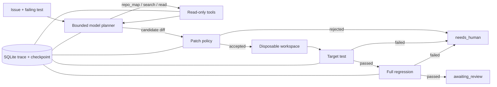

# TraceRepair

> A bounded, traceable, and test-gated code-repair agent.

[](https://github.com/zhangbeimiao/TraceRepair/actions/workflows/ci.yml)
[](https://zhangbeimiao.github.io/TraceRepair/)
[](https://github.com/zhangbeimiao/TraceRepair/releases/tag/v0.6.0)

**在线 Demo：<https://zhangbeimiao.github.io/TraceRepair/>**

Demo 只回放冻结并脱敏的真实 Trace，不需要 API Key，也不会产生模型费用。成功案例包含经过内容哈希校验的真实补丁 Diff 和四道验证门禁；失败区回放三类历史故障；恢复区展示进程在源码读取或补丁落盘后中断，如何从持久化 Checkpoint 继续而不重复已完成工具。

TraceRepair 是一个面向受信任小型 Python 仓库的受控代码修复 Agent。大模型负责在不确定环境中选择搜索、读取和补丁动作；确定性控制器负责权限、状态、成本、测试和人工审核。模型不能直接运行 Shell，也不能绕过验证门禁修改仓库。仓库差异由 JSON 任务配置描述，不再写死 EventRelay 路径。

当前项目版本为 `v0.6.0`，对应的冻结评测 Agent cohort 仍为 `0.4.0-dev1`。Checkpoint 恢复和跨仓库适配分别通过独立的零成本 Harness 验证；这些工程测试没有冒充新的模型成功率，也没有重跑锁定集。

## 评测结果

| 数据集 | Bug 类型 | 运行次数 | 成功 | 平均输出 Tokens | 平均工具调用 |
|---|---:|---:|---:|---:|---:|
| Development | 4 | 8 | 8/8 | 212.62 | 5.0 |
| Locked one-shot | 5 | 5 | 5/5 | 243.20 | 5.0 |
| Combined | 9 | 13 | 13/13 | 224.38 | 5.0 |

锁定集中的 `02、04、06、08、09` 每个只运行一次；测试期间没有重试失败案例，也没有修改模型 Prompt 或控制策略。完整证据保存在：

- `evaluation/frozen/devset-v0.4.0-dev1.json`
- `evaluation/frozen/testset-v0.4.0-dev1.json`
- `evaluation/frozen/release-summary-v0.4.0-dev1.json`
- `evaluation/frozen/failure-showcase-v0.4.0.json`
- `evaluation/frozen/recovery-showcase-v0.4.1.json`

这些数字只描述自建 EventRelay 受控基准，不能解释为对任意真实仓库都有 100% 修复率。

## 30 秒介绍

用户提交 Issue 和失败测试后，Agent 在最多三轮诊断中选择受限的代码搜索与读取工具，然后生成一次候选 unified diff。Diff 必须依次通过路径与变更量策略、目标测试和完整回归测试；全部通过后任务仍只进入 `awaiting_review`，等待人工确认。所有模型决策、工具生命周期、状态迁移和 checkpoint 都持久化到 SQLite。进程中断后，系统校验恢复工件或已修改文件的 SHA-256，再跳过已经成功的工具继续执行。

## 架构



| 模型负责 | 控制器负责 |
|---|---|
| 判断下一步搜索什么 | 限制可调用工具和参数 |
| 选择需要读取的源码 | 路径白名单和行数上限 |
| 根据证据提出候选 Diff | 补丁范围、体积和上下文校验 |
| 信息不足时请求人工处理 | Token、轮次、超时和状态机 |
| — | 目标测试、完整回归和人工审核 |

## 为什么需要 Agent

固定工作流可以执行已知步骤，但无法提前知道 Bug 位于哪个文件、应该搜索什么符号、需要读取哪段上下文。TraceRepair 让模型处理这些不确定决策，同时把写文件、执行测试和状态迁移留给可验证代码。

如果任务只是固定格式转换，直接调用 API 或普通工作流更合适；只有当下一步行动依赖前一步观察结果时，Agent 循环才有价值。

## 五分钟运行 Demo

项目必须放在 D 盘。首次安装：

```powershell
cd D:\AI-Agent-Intern\TraceRepair
powershell -ExecutionPolicy Bypass -File scripts\setup.ps1
```

执行完整测试、敏感信息扫描和 Demo 数据导出：

```powershell
powershell -ExecutionPolicy Bypass -File scripts\verify.ps1
```

启动本地 Web Demo：

```powershell
powershell -ExecutionPolicy Bypass -File scripts\start_demo.ps1
```

浏览器访问 `http://127.0.0.1:8765/`。Demo 使用已经冻结并脱敏的 Trace，不需要 API Key，也不会连接公网。页面中的 Diff 由故障快照与一次性修复工作副本重建，并用 Trace 中记录的 SHA-256 校验；它不是预先写死的示意代码。

运行不消耗 API Token 的两阶段崩溃恢复演示：

```powershell
python scripts\checkpoint_recovery_demo.py --crash-after source_read
python scripts\checkpoint_recovery_demo.py --crash-after patch_applied
```

两个命令都会关闭并重新打开 SQLite、重建运行时对象，并检查最终工具序列中没有重复项。`patch_applied` 场景恢复阶段的模型调用数为 0。

运行不消耗 API Token 的跨仓库演示：

```powershell
python scripts\generic_repository_demo.py
```

它会读取 `examples/tasks/mini-repo.json`，把独立 MiniMath 仓库复制到一次性工作区，确认目标测试先失败，再完成 `search → read → patch → target → regression` 并进入人工审核。

在同一个已配置百炼环境变量的 PowerShell 中补齐 5 次真实模型稳定性样本：

```powershell
python scripts\benchmark_repository.py
```

脚本会识别已有运行，只补齐缺少的样本；至少 4/5 成功后自动冻结跨仓库稳定性 manifest。

本地还准备了一个未发布源码、已固定 Git 快照的第二仓库。稳定性评测完成后，只运行一次锁定测试：

```powershell
python scripts\evaluate_locked_repository.py
```

该入口会拒绝脏工作区和第二次运行；无论首次结果成功或失败都会立即冻结，避免挑选结果。

终端版真实 Trace：

```powershell
python scripts\show_trace_demo.py --task-id model-agent-10-d9f35820
```

## 运行一次真实模型修复

在当前 PowerShell 会话中配置百炼环境变量。不要把真实值写入 `.env.example`、源码或命令截图：

```powershell
$env:DASHSCOPE_API_KEY = "<your-key>"
$env:TRACEREPAIR_BAILIAN_BASE_URL = "<your-compatible-mode-base-url>"
python scripts\smoke_bailian.py
python scripts\model_repair_agent.py --case 01
python scripts\model_repair_agent.py --task examples\tasks\mini-repo.json
```

真实模型运行也支持受控故障注入和恢复。第一次命令会打印可恢复的任务 ID：

```powershell
python scripts\model_repair_agent.py --case 05 --inject-crash-after patch_applied
python scripts\model_repair_agent.py --resume <task-id>
```

当前模型为 `qwen3.8-flash`。一次端到端运行最多包含三次只读诊断调用和一次补丁调用，总 completion 上限为 2,048 Tokens。

## 工具和安全边界

- `repo_map`：返回白名单文件和顶层符号，不返回测试目录。
- `search_code`：受长度与结果数量限制的文本搜索。
- `read_file`：只读取任务配置声明的源码白名单，限制行数。
- `apply_patch`：只接受策略通过的 unified diff，并写入一次性工作副本。
- `run_tests`：只允许预登记的 pytest 目标，不能接收 Shell 命令。
- `run_regression`：仅在目标测试成功后运行固定完整测试集。

关键约束：

- 模型输出始终视为不可信输入。
- 禁止任意 Shell、路径穿越、测试文件修改和生产访问。
- 补丁失败、工具超时、非法 JSON 或回归失败都会安全停止。
- Trace 不存储 API Key、源码正文、原始模型响应或完整测试输出。
- 工作副本、SQLite、缓存、虚拟环境和临时文件全部保留在 D 盘。
- 外部仓库先检查符号链接、文件数和总体积，再复制到一次性工作副本；不会直接修改原仓库。

## 可恢复状态与 Trace

每次运行记录任务状态、模型计划类型与 Token、工具生命周期、内容哈希、checkpoint、测试门禁和最终停止原因。`TraceStore` 使用 SQLite 保存结构化状态；源码切片只保存在一次性工作副本的恢复工件中，SQLite 仅记录相对路径和哈希。恢复支持 `source_read` 与 `patch_applied` 两个阶段，并拒绝被篡改的工件或工作副本。Web Demo 不展示绝对路径、原始模型响应或完整日志。

## 可靠评测设计

十个 EventRelay Bug 在独立一次性工作副本中注入：

- Development：`01、03、05、07、10`
- Locked：`02、04、06、08、09`

`0.3.0` 使用 case 05 调试并达到 4/5；`0.4.0-dev1` 冻结后在四个开发案例上达到 8/8，再保持同一版本对五个锁定案例进行一次性测试并达到 5/5。历史失败没有删除，仍可从 Trace 报告看到错误路由、诊断预算耗尽、非法补丁和上下文不匹配。

```powershell
python scripts\report_model_runs.py
python scripts\export_web_demo.py
```

## 项目结构

```text
TraceRepair/
├─ src/eventrelay/              正确基线服务
├─ src/tracerepair/             Agent、工具、策略、状态与评测
├─ examples/                    第二仓库与通用任务配置
├─ eventrelay_tests/            复制到工作副本的业务测试
├─ evaluation/
│  ├─ cases.json                10 个可复现 Bug
│  └─ frozen/                   不可变评测快照
├─ demo/dist/                   零依赖本地 Web Demo
├─ scripts/                     一键脚本与运行入口
├─ tests/                       TraceRepair 工程测试
└─ docs/                        设计决策与里程碑
```

## 已验证的工程故障

- 百炼模型 ID 不存在导致 HTTP 404；
- thinking 消耗 completion 预算导致响应被截断；
- 模型输出非法 JSON 或越权工具；
- 搜索范围过宽导致读取错误文件；
- 诊断轮次结束前没有读取源码；
- unified diff 格式不一致；
- patch context mismatch；
- 目标测试通过但完整回归失败。

这些失败通过结构化 Trace 定位，而不是隐藏或手工挑选成功结果。

## 当前限制

- 冻结模型评测仍基于 EventRelay；第二仓库证明通用工程管线可复用，但尚未形成跨仓库模型统计。
- pytest 会导入并执行仓库代码，因此当前只接受操作者拥有或信任的仓库；未知第三方代码仍需要容器沙箱。
- 当前定位是小型仓库，默认最多 2,000 个文件与 50 MiB，可在受控上限内配置。
- 外部仓库依赖必须预先安装在 D 盘虚拟环境中；任务配置不会执行依赖安装脚本。
- 代码检索目前是受限文本搜索，不是语义代码索引。
- 一次运行只允许一次补丁提案，失败后默认转人工，而不是无限自我修正。
- Web Demo 是脱敏的离线证据查看器，不在浏览器中托管 API Key 或直接执行 Agent。
- `awaiting_review` 表示测试通过但尚需人工审查，不等价于自动合并。

## 文档

- `docs/milestone-2-13.md`：确定性诊断恢复
- `docs/milestone-2-14.md`：Git diff 格式对齐
- `docs/milestone-3-02.md`：受限开发集基准
- `docs/milestone-3-03.md`：锁定集评测与 Trace 展示
- `docs/milestone-3-04.md`：冻结发布报告与本地 Web Demo
- `docs/releases/v0.4.1.md`：可验证 Diff 与失败恢复演示
- `docs/releases/v0.5.0.md`：Checkpoint 崩溃恢复
- `docs/configured-repositories.md`：通用仓库任务配置与安全边界
- `docs/repository-task.schema.json`：任务配置 JSON Schema
- `docs/releases/v0.6.0.md`：可配置仓库适配层

## 磁盘与依赖

项目不下载本地模型、不需要 Java、不依赖 Docker。当前包括 D 盘虚拟环境和历史工作副本在内仍远低于 30 GB 限制。
