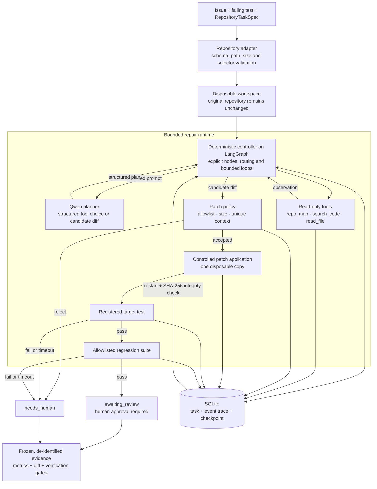

# TraceRepair agent architecture

TraceRepair separates uncertain model reasoning from deterministic execution.
The model can choose what evidence to inspect and propose one candidate diff;
it cannot write files, run arbitrary shell commands, skip tests, or mark its own
work as complete.



## Responsibility boundary

| Model responsibility | Deterministic system responsibility |
|---|---|
| Decide which symbol or file to inspect | Validate every tool name and argument |
| Interpret observations from source code | Enforce source-path and line-count limits |
| Propose one unified diff | Reject oversized, ambiguous, or out-of-scope patches |
| Hand off when evidence is insufficient | Cap turns, tokens, provider calls, and subprocess time |
| — | Run the registered target and regression tests |
| — | Persist trace/checkpoint state and require human review |

## Main execution path

```text
new -> ready -> diagnosis -> patch_generation -> controlled_verification
    -> target_test -> regression_test -> awaiting_review
```

Any invalid structured output, disallowed tool, patch-policy rejection, timeout,
target-test failure, regression failure, or integrity mismatch ends in
`needs_human`. The workflow does not loop indefinitely to make the metrics look
better.

Agent `0.7.0-dev1` represents this path as explicit LangGraph nodes:
`diagnose`, `checkpoint_source`, `generate_patch`, `apply_patch`, `run_target`,
`run_regression`, plus a `resume` router. The graph is compiled without a
LangGraph checkpointer. Graph state is ephemeral; after a restart the runtime
reconstructs its route from SQLite and verifies workspace hashes before it
skips any completed action. This prevents two persistence systems from
disagreeing about the authoritative task state.

## Crash recovery

Every model decision, state transition, and tool lifecycle event is appended to
SQLite. A checkpoint records the last durable stage and SHA-256 evidence for
relevant files. On restart, TraceRepair validates that evidence before skipping
completed work. In the `patch_applied` recovery scenario, the resumed process
makes zero model calls, does not apply the patch again, and only runs the target
and regression tests.

## Repository boundary

`RepositoryTaskSpec` moves repository-specific information out of tool code. It
defines the repository root, source allowlist, registered target test,
regression selector, Python path, and bounded size limits. TraceRepair currently
accepts trusted small Python repositories because pytest imports and executes
their code; unknown third-party code would require an additional container or
VM sandbox.

## Evidence boundary

- Real historical benchmark: Agent 0.6.0 completed 3/5 pass@1 across five
  repositories; development was 2/3 and the one-shot locked split was 1/2.
  Both failures stopped at the target-test gate, and no incorrect patch was
  accepted.
- EventRelay controlled benchmark: 13/13 successful frozen runs.
- Public configured repository: 5/5 repeat runs, 179.6 average output tokens.
- Held-out trusted repository: 1/1 strict one-shot run, 234 output tokens,
  three model calls, five tool calls, and no retry.

These are deliberately reported as separate protocols. They do not
constitute a claim of 100% accuracy on arbitrary Python repositories.
